# Hello World: AWS Lambda and API Gateway in Java

Implementation of the workshop from Escuela Colombiana de Ingeniería Julio
Garavito. The service calculates the square of an integer through an AWS
Lambda function invoked from an API Gateway GET endpoint.

## Requirements

- Java 25 LTS (the artifact is compiled with `--release 25`).
- Maven 3.9 or later.
- An AWS account with permission to create Lambda and API Gateway resources.
  AWS Academy users can use the `LabRole` execution role.

If several JDKs are installed, make sure `JAVA_HOME` points to JDK 25 before
building, otherwise Maven fails with `release version 25 not supported`.

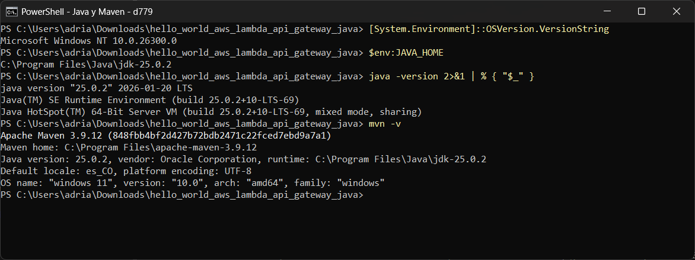

## Build and test locally

From the repository root:

```bash
mvn clean test
mvn package
```

All three unit tests pass:

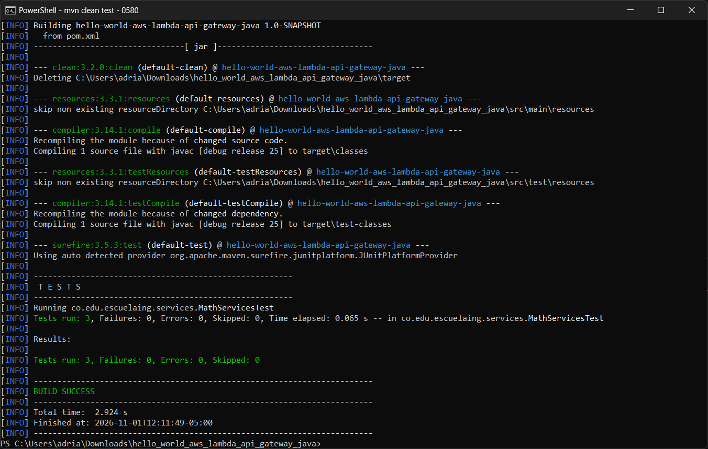

The JAR to upload to Lambda is generated at
`target/hello-world-aws-lambda-api-gateway-java-1.0-SNAPSHOT.jar`; it contains
only `MathServices.class`, so no extra dependencies need to be bundled.

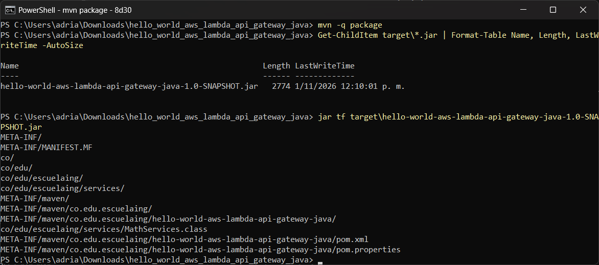

## Create the Lambda function

1. In AWS Lambda, select **Create function** > **Author from scratch**.
2. Name the function `square`, select the Java 25 runtime (or the equivalent
   current AWS-managed Java runtime), and select `LabRole` or a custom
   execution role.
3. Upload the generated JAR in the **Code** section.
4. Set the handler to:

   ```text
   co.edu.escuelaing.services.MathServices::square
   ```

5. Create a test event whose content is only the number `5`, not a JSON object.
   The expected result is `25`.

The `square(Integer)` signature allows Lambda to deserialize the numeric value
as the handler's first parameter.

### Evidence

The AWS steps were run from Windows PowerShell with AWS CLI v2 against an AWS
Academy Learner Lab account (`us-east-1`), using `LabRole` as the execution
role. Each command is shown in the screenshot together with its output.

Function `square` created with the `java25` runtime, the `LabRole` role and the
`co.edu.escuelaing.services.MathServices::square` handler:

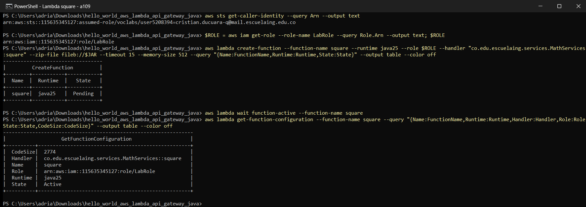

Invocation with the plain payload `5` (the `testSquare` event) returns `25`;
`14` returns `196`:

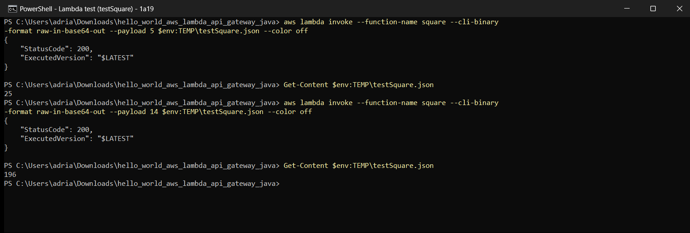

## Expose the function through API Gateway

1. Create a regional **REST** API named `mathServices`.
2. Create a **GET** method and select the `square` Lambda function.
3. In **Method Request**, add the `value` query string parameter.
4. In **Integration Request**, configure the input parameter `value` with
   `method.request.querystring.value`.
5. Add a mapping template for the request content type (for example,
   `application/json`) with the following content:

   ```velocity
   $input.params("value")
   ```

   The template sends only the integer to Lambda, which is what the handler
   expects. Do not wrap it in a JSON object.
6. Test the method with `value=14`; the expected response is `196`.
7. Deploy the API to a stage, for example `Beta`, and call:

   ```text
   https://<api-id>.execute-api.<region>.amazonaws.com/Beta?value=14
   ```

If `value` is omitted, the mapping does not produce a valid integer and the
invocation should be treated as invalid input. Delete the Lambda function and
the API after completing the workshop to avoid unnecessary charges.

### Evidence

Regional REST API `mathServices` with a `GET` method on `/` and the optional
`method.request.querystring.value` parameter in **Method Request**:

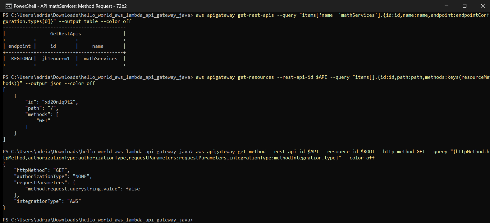

**Integration Request** of type `AWS` (Lambda, non-proxy) mapping
`integration.request.querystring.value` from
`method.request.querystring.value`, with the `application/json` mapping
template `$input.params("value")`:

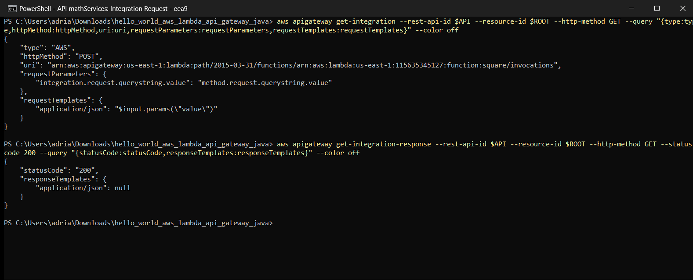

Method test: `value=14` returns `196`, `value=5` returns `25`, and calling it
without `value` makes Lambda report a JSON parsing error, as the workshop
expects:

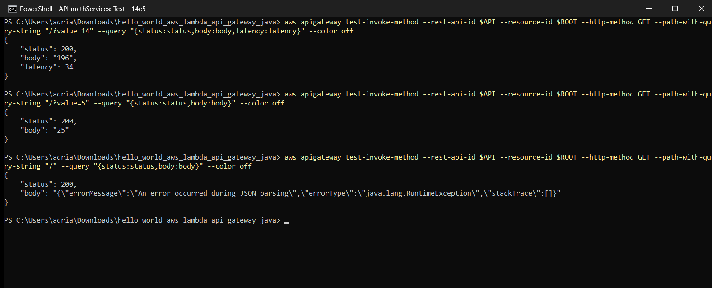

Deployment to the `Beta` stage and call to the public invoke URL from
PowerShell (`value=14` returns `196`, `value=7` returns `49`):

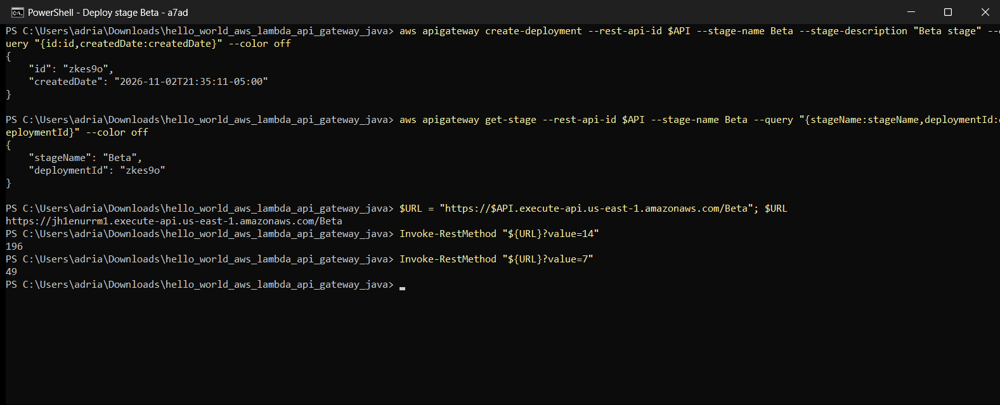

Same invoke URL opened in Microsoft Edge:

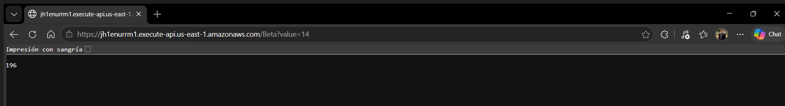

## Cleanup

The API and the Lambda function were deleted after the workshop. The listings
come back empty and the invoke URL no longer returns a result:

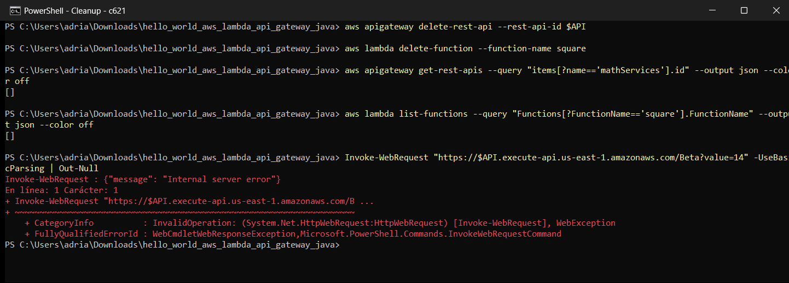

## Project structure

```text
src/main/java/co/edu/escuelaing/services/MathServices.java  # handler Lambda
src/test/java/.../MathServicesTest.java                     # unit tests
pom.xml                                                     # Maven build
docs/images/                                                # lab screenshots
```
